# Turinio ribojimo sistema mokyklos bevieliui

KTU T120B145 „Kompiuterių tinklai ir internetinės technologijos“ – IT projektas.
Autorius: Martynas Matutis. Technologijos: PHP, MySQL, Docker.

## Užduotis

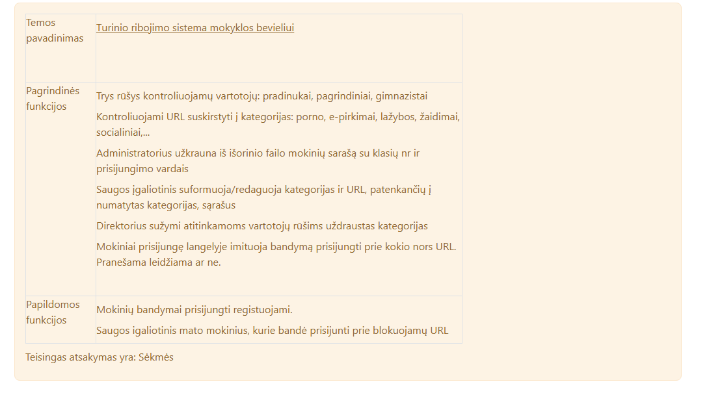

Sistemos paskirtis – mokyklos bevielio tinklo turinio ribojimas:

- Trys kontroliuojamų vartotojų (mokinių) rūšys: pradinukai, pagrindiniai, gimnazistai.
- Kontroliuojami URL suskirstyti į kategorijas: porno, e. pirkimai, lažybos, žaidimai, socialiniai tinklai ir kt.
- **Administratorius** užkrauna iš išorinio failo mokinių sąrašą su klasių numeriais ir prisijungimo vardais.
- **Saugos įgaliotinis** suformuoja ir redaguoja kategorijas bei į jas patenkančių URL sąrašus.
- **Direktorius** pažymi, kurios kategorijos uždraustos kurioms mokinių rūšims.
- **Mokiniai**, prisijungę prie sistemos, langelyje imituoja bandymą atidaryti URL, o sistema praneša, ar tai leidžiama.
- Papildomai: mokinių bandymai registruojami, o saugos įgaliotinis mato mokinius, bandžiusius atidaryti blokuojamus URL.

## Paleidimas (Docker)

```bash
cd turinio_ribojimas
./paleisti.sh                # arba: bash paleisti.sh, arba: docker compose up -d --build
```

- Sistema: http://localhost:8080
- phpMyAdmin: http://localhost:8001 (stud / stud)
- Sustabdyti: `./sustabdyti.sh` (duomenys išlieka)
- Grąžinti pradinius duomenis: `./atstatyti_duomenis.sh`

Jei reikia, prieš docker komandas rašykite `sudo`. Pirmą kartą reikia interneto
(atsiunčiami `php:8.2-apache`, `mysql:8.4`, `phpmyadmin/phpmyadmin`).

## Prisijungimai

| Rolė | Vardas | Slaptažodis |
|---|---|---|
| Administratorius | admin | admin123 |
| Saugos įgaliotinis | saugos | saugos123 |
| Direktorius | direktorius | direktorius123 |
| Mokinys (pradinukas, 2A) | jonas.petraitis | mokinys123 |
| Mokinys (pagrindinis, 7A) | nojus.urbonas | mokinys123 |
| Mokinys (gimnazistas, IIIG) | karolis.zilinskas | mokinys123 |

Visi kontroliniai mokiniai turi slaptažodį `mokinys123` (`arnas.bernotas` – užblokuotas).

## Paleidimas be Docker (VM Apache + MySQL, PHP 7.2+)

```bash
sudo mysql < sqldump/01_schema.sql
sudo mysql < sqldump/02_duomenys.sql
sudo mysql -e "CREATE USER IF NOT EXISTS 'stud'@'localhost' IDENTIFIED BY 'stud'; GRANT ALL ON turinio_ribojimas.* TO 'stud'@'localhost';"
sudo cp -r www /var/www/html/turinio_ribojimas
```
Faile `www/inc/config.php` pakeiskite DB serverį `mysql` → `localhost`.
Adresas: http://localhost/turinio_ribojimas/

## Struktūra

- `www/` – PHP kodas (`admin_*`, `saugos_*`, `direktorius_*`, `mokinys_*` puslapiai, `inc/` – bendras kodas)
- `sqldump/` – DB struktūra ir kontroliniai duomenys
- `pavyzdiniai_failai/` – CSV failai mokinių importui (teisingas ir su klaidomis)

## Diagramos

### Panaudojimo atvejų diagrama
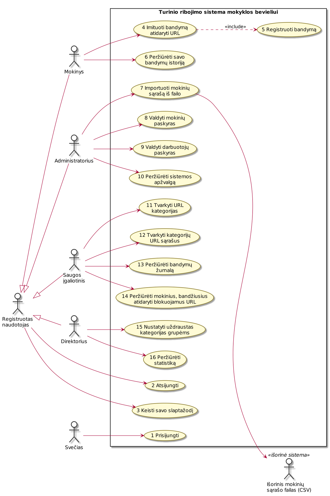

### Esybių ryšių diagrama (duomenų bazės loginis modelis)
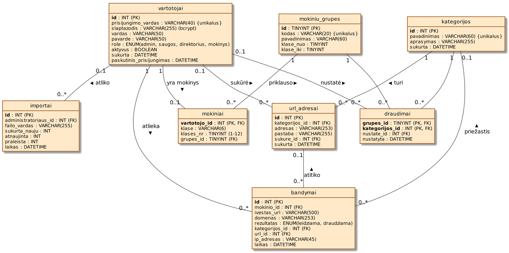

## Ekrano nuotraukos

### Prisijungimas
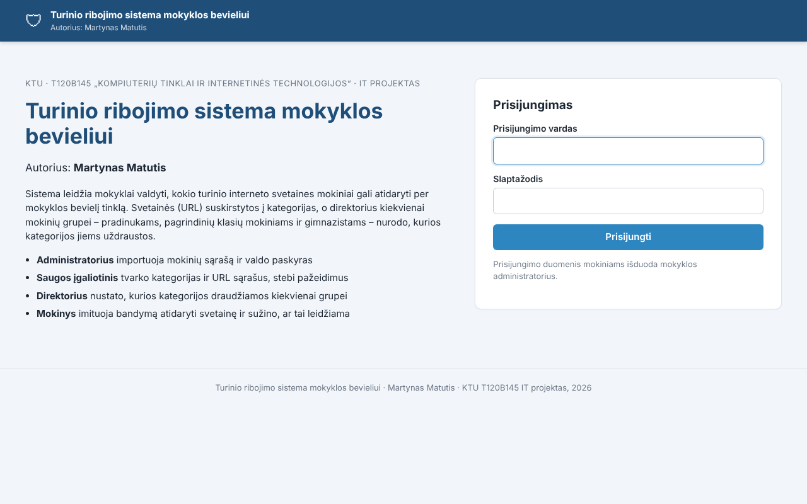

### Mokinys – prieigos tikrinimas
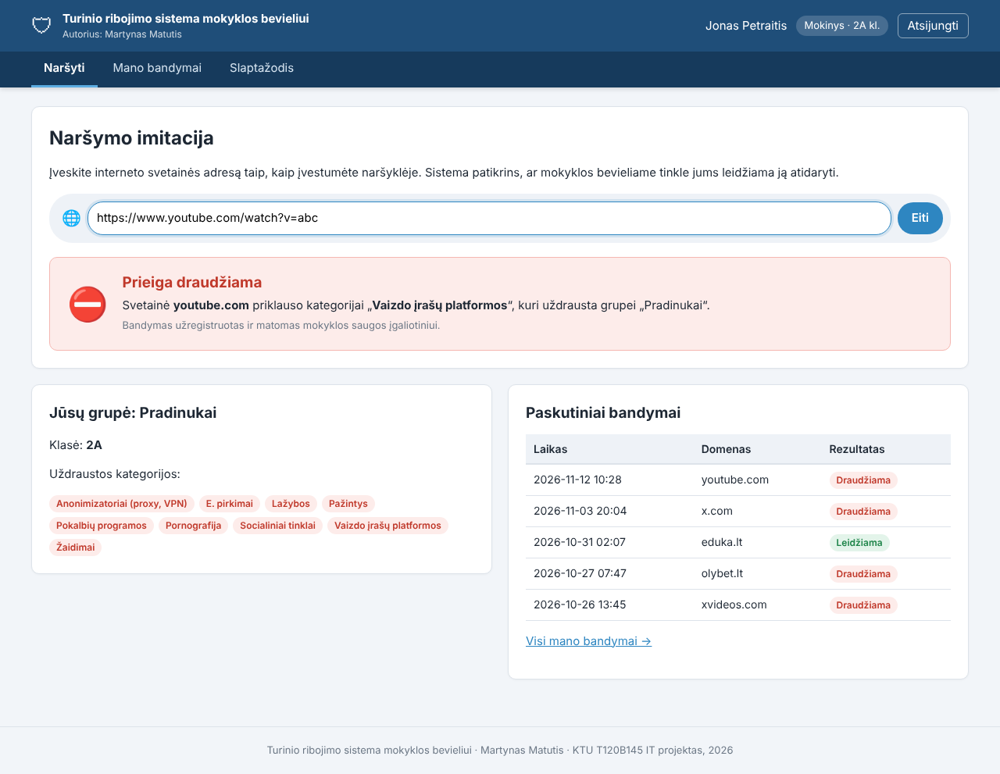
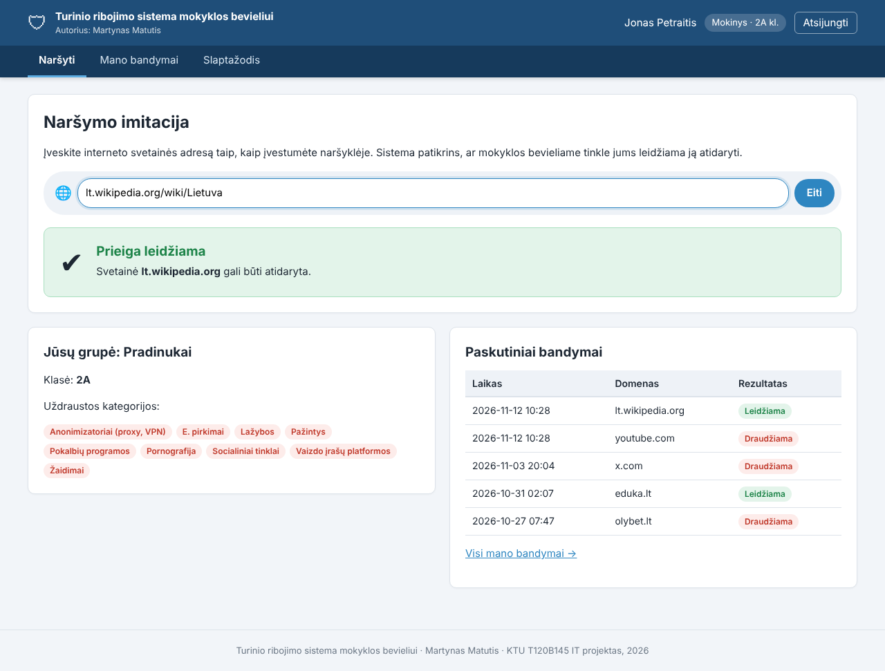

### Saugos įgaliotinis
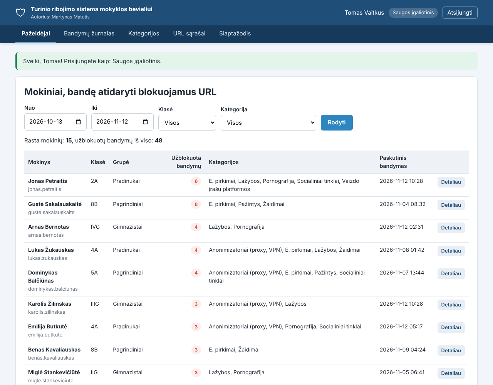
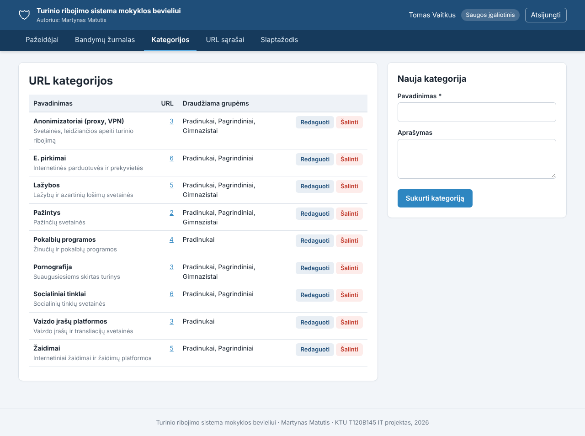
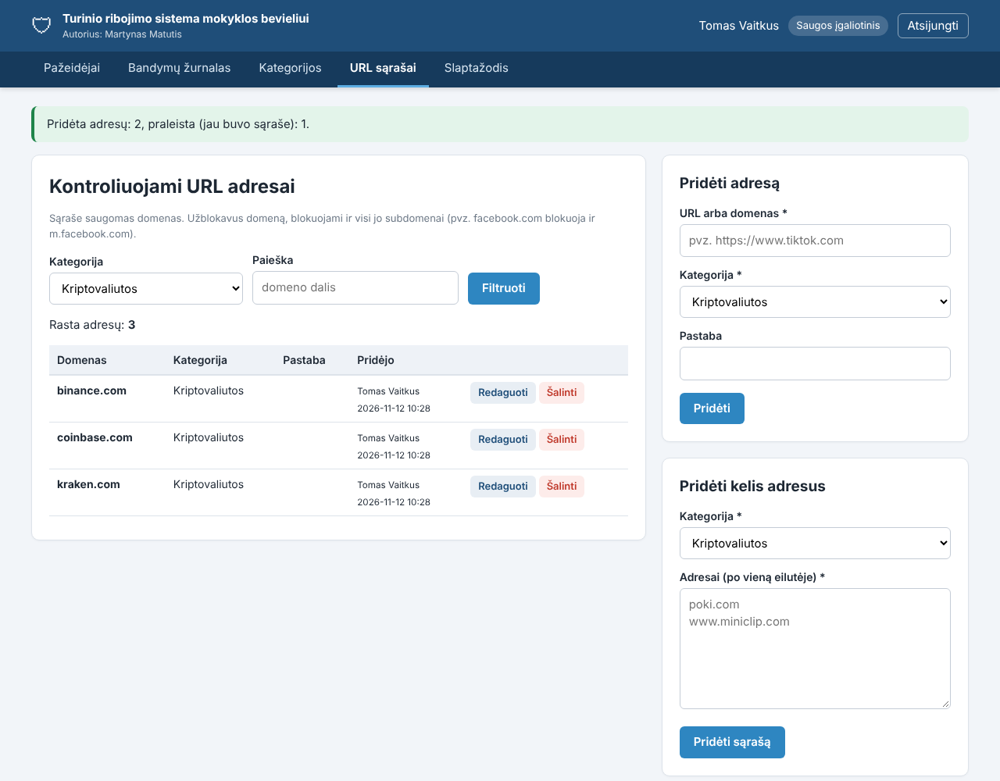

### Direktorius
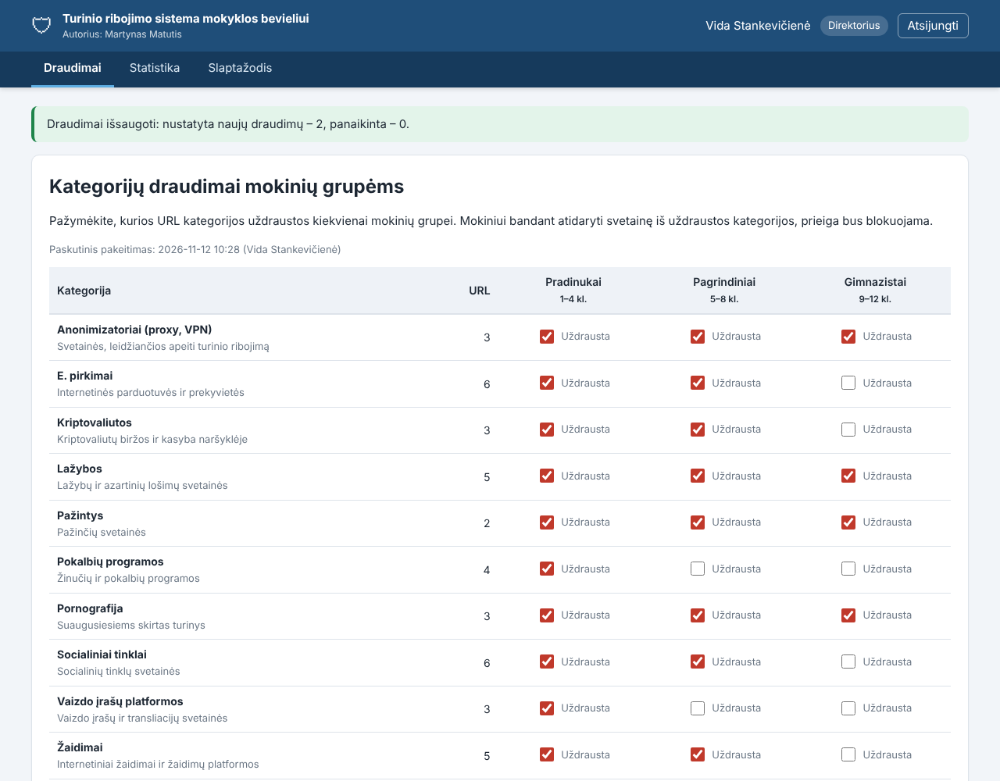
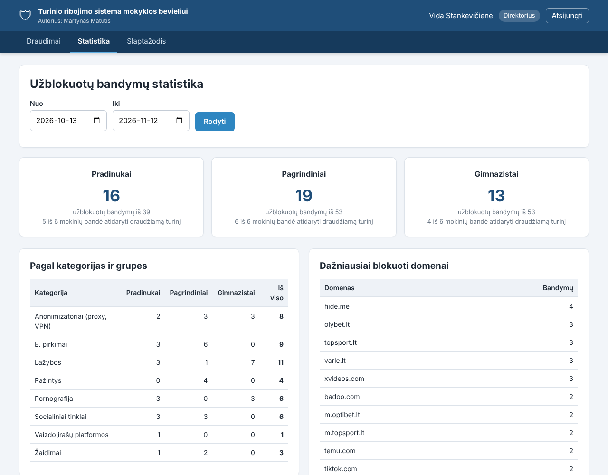

### Administratorius
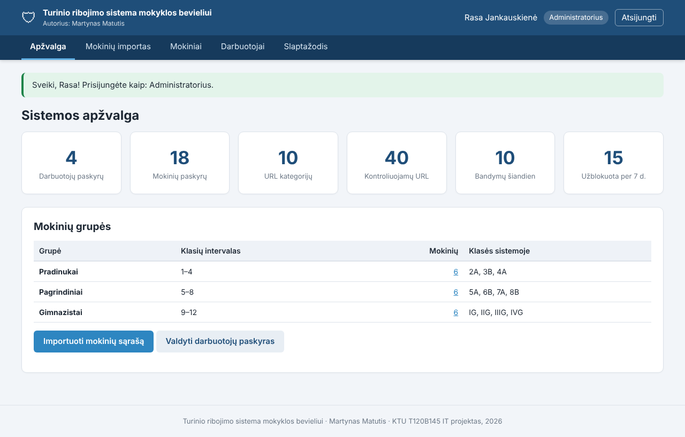
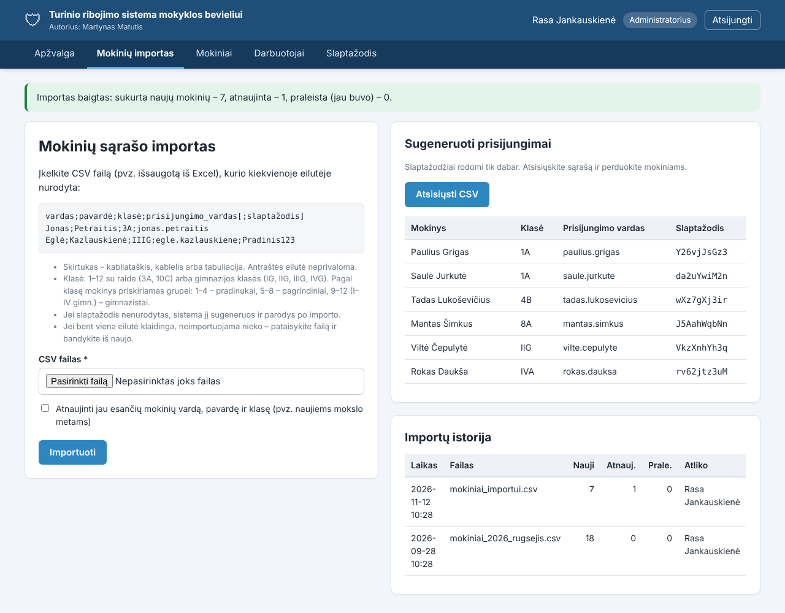
